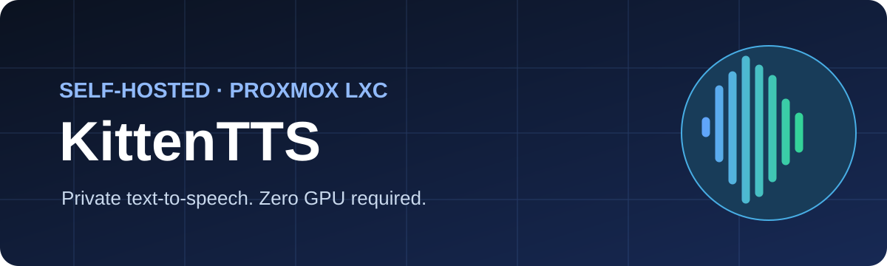
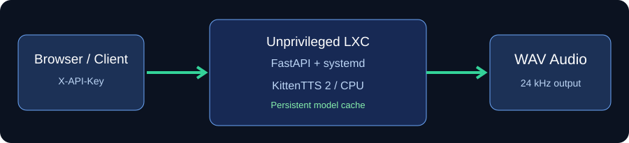

# 🐱 KittenTTS for Proxmox

<p align="center">
  
</p>

<p align="center">
  
  
  
  
  <a href="https://github.com/ThamerLab/kittentts-proxmox/actions/workflows/checks.yml"></a>
</p>

**Your voice AI. Your hardware. Your rules.** A community-built, self-hosted web UI and REST API for [KittenTTS 2](https://github.com/KittenML/KittenTTS), deployed as an **unprivileged LXC** on Proxmox VE. No Docker-in-LXC needed.

> [!IMPORTANT]
> **Community beta / not yet tested on real Proxmox hardware.** The installer and API have static checks and CI, but installation, model download, and audio synthesis still need real-host validation. This is **not** an official Proxmox Community Scripts or KittenML project.



## ✨ Features

- 🎙️ 47 built-in KittenTTS 2 voices, including an Arabic voice
- 🧠 CPU inference, optional compact `emb4` weights
- 🌍 Simple Arabic/English browser interface; WAV downloads
- 🔌 `GET /health`, `GET /api/voices`, `POST /api/tts`, interactive `/docs`
- 🛡️ Unprivileged LXC, restricted systemd service, API key authentication
- 🖥️ Native Proxmox Console + `kittentts-ctl` terminal management
- 🔁 Automatic start on reboot; persistent Hugging Face cache

## 🚀 Quick start

**Run from the Proxmox host shell as root.** The host must be an x86-64 Proxmox VE 8/9 system with working internet, available `rootdir` and `vztmpl` storages, and a DHCP-enabled bridge (default `vmbr0`).

```bash
apt-get update && apt-get install -y git
git clone https://github.com/ThamerLab/kittentts-proxmox.git
cd kittentts-proxmox
bash install.sh
```

The installer prompts for default or advanced settings; advanced mode lets you select CT ID, CPU, RAM, disk, storages and network bridge. **Review the script before running it as root.** Do not pipe a remote URL directly to `bash`.

| Resource | Default | Notes |
|:--|:--|:--|
| vCPU | 4 | CPU only, speed depends on hardware |
| Memory | 8192 MiB | Model upstream recommends about 6 GB on CPU |
| Disk | 20 GiB | OS, Python dependencies, cache and WAV generation |
| Swap | 1024 MiB | Do not substitute for adequate RAM |
| OS | Debian 12 LXC | Unprivileged, native Python + systemd |
| Port | 8787 | LAN access only by default assumption |

After installation open **`http://CONTAINER_IP:8787`** from your trusted LAN. Retrieve the generated API key inside the container with:

```bash
pct enter YOUR_CT_ID
sudo -n true 2>/dev/null || true
grep '^API_KEY=' /etc/kittentts.env
```

Paste the key into the browser UI, click **Load voices**, select one, then generate audio.

## 🖥️ Terminal & maintenance

Use Proxmox → your container → **Console**, or `pct enter YOUR_CT_ID` on the Proxmox host.

```bash
kittentts-ctl                       # interactive management
systemctl status kittentts --no-pager
journalctl -u kittentts -f
nano /etc/kittentts.env
systemctl restart kittentts
```

The service source is located under `/opt/kittentts-home/app/` and the model cache under `/var/lib/kittentts/cache/`. Configuration changes need a restart. Package updates can introduce breaking changes; take a Proxmox snapshot or backup beforehand.

## 🔌 API examples

```bash
curl http://CONTAINER_IP:8787/health
curl -H "X-API-Key: YOUR_KEY" http://CONTAINER_IP:8787/api/voices
curl -X POST http://CONTAINER_IP:8787/api/tts \
  -H "X-API-Key: YOUR_KEY" -H "Content-Type: application/json" \
  -d '{"text":"Hello from my server.","voice":"Luna"}' \
  --output speech.wav
```

Open `http://CONTAINER_IP:8787/docs` for FastAPI documentation. The browser interface does **not** expose a terminal: use the actual Proxmox LXC Console.

## 🔒 Security and privacy

> [!CAUTION]
> **Never expose port 8787 directly to the public internet.** API keys sent over plain HTTP can be intercepted, including on untrusted networks. Use an authenticated HTTPS reverse proxy or VPN for remote access. The `/health` endpoint and documentation are intentionally public. This app has no account system, request quotas, or built-in TLS.

- API key is generated inside the CT and stored at `/etc/kittentts.env` with mode 0600; never commit it.
- The service runs as a dedicated non-login user, with systemd filesystem protections.
- The first request to voices/speech triggers model download and can take significant time.
- Output audio is returned in memory (not saved to a server-side output directory).
- Use trusted model repositories and review any updates before installation.

## 🧩 Troubleshooting

| Symptom | Check |
|:--|:--|
| Container has no IP | Verify bridge, DHCP, DNS and `pct exec CTID -- ip a` |
| No audio / model error | `journalctl -u kittentts -n 100 --no-pager` |
| HTTP 401 | Supply `X-API-Key` from `/etc/kittentts.env` |
| First call is slow | Model download, cache initialization and CPU inference |
| Installer fails | Check space, `pveam` template access, DNS and apt/pip output |
| Container created, setup fails | Inspect existing CT; script deliberately refuses to overwrite it |

## 📚 Attribution & licensing

This repository is an **independent community wrapper**, not affiliated with Proxmox Server Solutions, Community Scripts, or KittenML. Application/installer code here is MIT licensed (see LICENSE). The upstream [KittenTTS source code](https://github.com/KittenML/KittenTTS) is Apache-2.0; **KittenTTS 2 model weights carry their own Stellon Labs Community License**, which is separate and may restrict commercial usage. Review the [model card](https://huggingface.co/KittenML/kitten-tts-2) before deployment.

We welcome issues and pull requests, especially tested Proxmox 8/9 installation reports. Include host version, sanitized logs, and steps to reproduce; **never share API keys**.
